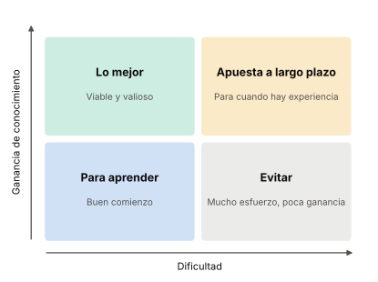

# Capítulo 1. Pensar estratégicamente {#sec-cap1}

::: {.callout-note appearance="default"}
## Objetivos
- Elegir problemas de investigación con criterios explícitos: interés, viabilidad y ventaja propia.
- Construir una línea de investigación coherente a medio plazo.
- Analizar tu posición con herramientas sencillas (DAFO, cartera de proyectos).
:::

::: {.callout-note appearance="simple" icon="false"}
## Glosario del capítulo
[Estrategia](92-glosario.qmd#gl-estrategia) · [Línea de investigación](92-glosario.qmd#gl-linea) · [Ventaja propia](92-glosario.qmd#gl-ventaja) · [Cartera de proyectos](92-glosario.qmd#gl-cartera) · [DAFO](92-glosario.qmd#gl-dafo) · [Coste de oportunidad](92-glosario.qmd#gl-oportunidad)
:::

::: {.callout-tip appearance="simple" icon="false"}
## Descargas
[Plantilla de entrega del reto (.qmd)](plantillas/entrega_reto.qmd){.btn .btn-outline-primary .btn-sm download="entrega_reto.qmd"}
[Tema de estilo (.scss)](plantillas/informe.scss){.btn .btn-outline-primary .btn-sm download="informe.scss"}
:::

## Lectura obligatoria

::: {.lectura}
Alon, U. (2009). [How to choose a good scientific problem](https://doi.org/10.1016/j.molcel.2009.09.013). *Molecular Cell*, 35(6), 726-728.
:::

## 1. Qué es la estrategia en investigación

Una **estrategia** es un conjunto coherente de decisiones sobre a qué dedicar recursos escasos (sobre todo, tiempo y atención) para alcanzar objetivos a medio plazo. Lo esencial de una estrategia es lo que se **deja de hacer**: cada proyecto que aceptas tiene un **coste de oportunidad**, el de los proyectos que no podrás hacer.

En investigación, una buena estrategia responde a tres preguntas:

1. **¿Qué problemas merecen mi tiempo?** (interés, impacto, viabilidad).
2. **¿Dónde tengo ventaja?** Tu combinación de conocimientos, datos, métodos, contactos y contexto que pocos tienen.
3. **¿Cómo encajan mis proyectos entre sí?** Una **línea de investigación** es una secuencia de preguntas conectadas en la que cada resultado facilita el siguiente.

## 2. Elegir problemas

@alon2009 propone valorar cada problema en dos ejes: **dificultad** (cuánto tiempo y esfuerzo exige) y **ganancia de conocimiento** (cuánto avanzaría la comprensión si sale bien). Para un doctorando, conviene empezar por problemas **fáciles y de interés moderado o alto**, que permiten aprender y publicar; los problemas difíciles y de gran interés son apuestas de largo plazo para cuando hay experiencia. Insiste además en dos ideas:

- **Elige con calma.** Dedica tiempo explícito (semanas, no horas) a elegir el problema; es la decisión con más consecuencias.
- **Escúchate.** El interés propio es un buen predictor de que perseverarás cuando haya dificultades.

Y añade algo que todo investigador vive: el camino rara vez va en línea recta de A a B. Entre la pregunta y la respuesta suele haber una fase de confusión, «la nube», en la que nada funciona. Saberlo de antemano ayuda a no abandonar, y a veces lo que se encuentra en la nube es mejor que el objetivo inicial.

{#fig-e1-alon fig-alt="Matriz de dos por dos con la dificultad en el eje horizontal y la ganancia de conocimiento en el vertical. Fácil y gran ganancia: lo mejor. Fácil y poca ganancia: buen comienzo para aprender. Difícil y gran ganancia: apuesta a largo plazo. Difícil y poca ganancia: evitar."}

## 3. Una cartera equilibrada

Como en las inversiones, conviene combinar proyectos con riesgos distintos: una **cartera de proyectos** con algunos seguros (análisis de datos que ya tienes, colaboraciones consolidadas), algunos de riesgo medio y uno o dos ambiciosos. Así los resultados no dependen de una única apuesta.

## 4. Analizar tu posición: DAFO

El análisis **DAFO** organiza las **debilidades** y **fortalezas** (internas) y las **amenazas** y **oportunidades** (externas). Útil para preparar un plan de carrera, una solicitud de financiación o la estrategia de un grupo. La clave es convertir el análisis en decisiones: usar fortalezas para aprovechar oportunidades y corregir debilidades que te expongan a amenazas.

## Laboratorio: tu cartera de problemas {#lab-e1-cartera}

::: {.laboratorio}
::: {.laboratorio-etiqueta}
Laboratorio · se ejecuta en tu navegador; tus datos no salen de él
:::

Escribe hasta cinco ideas de proyecto, una por línea, con el formato `idea; dificultad (1-5); ganancia (1-5)`. El laboratorio las sitúa en la matriz de Alon y valora el equilibrio de tu cartera.

```{ojs}
//| echo: false
area = window.Lab.area
viewof ideas = area("Ideas de proyecto", {rows: 5, submit: "Situar", value: "Revisión sistemática del tema de la tesis; 2; 3\nReanálisis de los datos del grupo con nuevos métodos; 2; 4\nEncuesta internacional propia; 4; 4\nNuevo método de medición; 5; 5\nCapítulo descriptivo de la base de datos; 1; 1"})
```

```{ojs}
//| echo: false
{
  const filas = ideas.split("\n").map(l => l.split(";").map(s => s.trim())).filter(f => f.length >= 3 && f[0]).slice(0, 5)
    .map(([t, d, g]) => ({t, d: Math.min(5, Math.max(1, +d || 3)), g: Math.min(5, Math.max(1, +g || 3))}));
  const cuad = f => f.d <= 3 && f.g >= 3 ? "Lo mejor: viable y valioso" : f.d <= 3 ? "Buen comienzo para aprender" : f.g >= 3 ? "Apuesta a largo plazo" : "Mejor evitarlo";
  const X = d => 60 + (d - 1) * 105, Y = g => 280 - (g - 1) * 60;
  const pts = filas.map((f, i) => `<circle cx="${X(f.d)}" cy="${Y(f.g)}" r="13" fill="#2a78d6" stroke="var(--bs-body-bg)" stroke-width="2"/><text x="${X(f.d)}" y="${Y(f.g) + 4.5}" text-anchor="middle" font-size="13" font-weight="700" fill="#fff">${i + 1}</text>`).join("");
  const seguros = filas.filter(f => f.d <= 2).length, apuestas = filas.filter(f => f.d >= 4 && f.g >= 4).length, malos = filas.filter(f => f.d >= 3 && f.g <= 2).length;
  const consejo = !filas.length ? "Escribe al menos una idea." : seguros === 0 ? "Tu cartera no tiene proyectos seguros: añade uno viable a corto plazo para no depender solo de apuestas." :
    apuestas === 0 ? "No hay ninguna apuesta ambiciosa: valora incluir un proyecto difícil de gran interés, a largo plazo." :
    apuestas > 2 ? "Demasiadas apuestas a la vez: el riesgo de quedarte sin resultados es alto." : "Cartera equilibrada: combina proyectos seguros y alguna apuesta.";
  const d = html`<div role="status"></div>`;
  d.innerHTML = `<svg viewBox="0 0 540 320" width="100%" style="max-width:540px" role="img" aria-label="Matriz de dificultad y ganancia con las ideas numeradas">
    <rect x="40" y="10" width="240" height="140" fill="#1baf7a" opacity=".16"/><rect x="280" y="10" width="240" height="140" fill="#eda100" opacity=".16"/>
    <rect x="40" y="150" width="240" height="140" fill="#2a78d6" opacity=".12"/><rect x="280" y="150" width="240" height="140" fill="#a3a29e" opacity=".18"/>
    <text x="50" y="28" font-size="12" fill="currentColor">Lo mejor</text><text x="510" y="28" text-anchor="end" font-size="12" fill="currentColor">Apuesta a largo plazo</text>
    <text x="50" y="282" font-size="12" fill="currentColor">Para aprender</text><text x="510" y="282" text-anchor="end" font-size="12" fill="currentColor">Evitar</text>
    <text x="280" y="312" text-anchor="middle" font-size="12" fill="currentColor">Dificultad →</text><text x="20" y="150" text-anchor="middle" font-size="12" fill="currentColor" transform="rotate(-90 20 150)">Ganancia →</text>${pts}</svg>
    <ol>${filas.map(f => `<li>${f.t.replace(/</g, "&lt;")}: <strong>${cuad(f)}</strong></li>`).join("")}</ol>
    <p style="font-weight:600" class="${seguros && apuestas && apuestas <= 2 ? "lab-bien" : "lab-medio"}">${consejo}</p>${malos ? `<p class="small">${malos} idea${malos > 1 ? "s" : ""} con mucho esfuerzo y poca ganancia: ¿puedes reformularla${malos > 1 ? "s" : ""} o descartarla${malos > 1 ? "s" : ""}?</p>` : ""}`;
  return d;
}
```
:::

## Caso práctico resuelto

::: {.callout-note appearance="simple" icon="false"}
## Priorizar una cartera de cinco proyectos
Una posdoc tiene cinco ideas y tiempo para dos o tres este año. Aplicando la matriz de Alon y la cartera equilibrada:

| Idea | Dificultad | Ganancia | Decisión |
|---|---|---|---|
| Reanálisis de datos del grupo con un método nuevo | 2 | 4 | **Hacer ya**: viable y valioso |
| Revisión sistemática del tema | 2 | 3 | **Hacer**: base para la línea |
| Encuesta internacional propia | 4 | 4 | **Apuesta**: preparar la solicitud de financiación |
| Nuevo instrumento de medida | 5 | 5 | **Aplazar** dos años, cuando haya equipo |
| Capítulo descriptivo de la base de datos | 1 | 1 | **No hacer** o delegarlo como práctica |

El criterio explícito ayuda a decir que no sin culpa: cada sí tiene un coste de oportunidad.
:::

## Segundo caso práctico resuelto

::: {.callout-note appearance="simple" icon="false"}
## Un DAFO que termina en decisiones
Un grupo pequeño de documentación (tres personas) prepara su plan a tres años. Su DAFO inicial es una lista de 20 puntos que no lleva a ninguna parte. Lo rehacen cruzando los cuadrantes, que es donde el análisis se convierte en estrategia:

| Cruce | Pregunta | Decisión |
|---|---|---|
| Fortaleza × oportunidad | ¿Qué fortaleza nos deja aprovechar una oportunidad? | Tenemos datos propios de repositorios y hay una convocatoria sobre ciencia abierta: **solicitarla**. |
| Debilidad × oportunidad | ¿Qué debilidad nos impide aprovecharla? | Nadie programa con soltura: **formación en R** el primer semestre. |
| Fortaleza × amenaza | ¿Qué fortaleza nos protege? | Colaboración estable con un grupo extranjero: **coautorías** si se recorta la financiación nacional. |
| Debilidad × amenaza | ¿Qué combinación nos pone en riesgo? | Todo depende de una persona con contrato temporal: **documentar procesos** y repartir tareas. |

El resultado son cuatro decisiones con responsable y fecha, no veinte observaciones. Si un punto del DAFO no cambia ninguna decisión, sobra.
:::

```{dot}
//| label: fig-e1-dafo-cruce
//| fig-cap: "Del DAFO a las decisiones: cada cruce de cuadrantes sugiere un tipo de acción."
//| fig-alt: "Diagrama con cuatro cajas: fortalezas, debilidades, oportunidades y amenazas. Las flechas cruzan cada factor interno con cada externo y llevan a cuatro tipos de acción: aprovechar, corregir, defender y reducir el riesgo."
digraph {
  bgcolor="white"; pad=0.2; rankdir=LR;
  node [shape=box, style="rounded,filled", fillcolor="#eef3fb", color="#1a4d8f", fontname="Helvetica", fontsize=11];
  edge [color="#45433f", fontname="Helvetica", fontsize=10];
  F [label="Fortalezas"]; D [label="Debilidades"]; O [label="Oportunidades", fillcolor="#eaf6ef"]; A [label="Amenazas", fillcolor="#fdf0e8"];
  a1 [label="Aprovechar\n(FO)", shape=ellipse]; a2 [label="Corregir\n(DO)", shape=ellipse]; a3 [label="Defender\n(FA)", shape=ellipse]; a4 [label="Reducir riesgo\n(DA)", shape=ellipse];
  F -> a1; O -> a1; D -> a2; O -> a2; F -> a3; A -> a3; D -> a4; A -> a4;
}
```

## Ejercicios graduados

**Básico.** ¿Qué hacer con una idea de dificultad 5 y ganancia 2?

::: {.webex-solution boton="Ver solución"}
Evitarla o reformularla: exige mucho esfuerzo para poco avance del conocimiento.
:::

**Avanzado.** Prioriza tus propias ideas con la tabla del caso y escribe qué dejarás de hacer este año.

::: {.webex-solution boton="Ver solución"}
La justificación debe usar los criterios (interés, viabilidad, ventaja propia) y tener en cuenta el equilibrio entre proyectos seguros y apuestas.
:::


## Actividades

::: {.clasificar #ia-e1-alon titulo="¿En qué cuadrante de Alon está?" categorias="Lo mejor|Para aprender|Apuesta a largo plazo|Evitar"}
- Aplicar un método nuevo y sencillo a unos datos públicos que nadie ha analizado así → Lo mejor
- Reproducir un análisis clásico con los datos originales para aprender el método → Para aprender
- Desarrollar una teoría que unifique dos campos alejados → Apuesta a largo plazo
- Recoger a mano miles de datos para confirmar algo ya bien establecido → Evitar
:::

::: {.clasificar #ia-e1-dafo titulo="Clasifica en el DAFO de una doctoranda" categorias="Fortaleza|Debilidad|Oportunidad|Amenaza"}
- Domina un método de análisis poco extendido en su campo → Fortaleza
- Aún no tiene publicaciones como primera autora → Debilidad
- Se abre una convocatoria de estancias internacionales → Oportunidad
- Otro grupo publica un estudio muy parecido al suyo → Amenaza
- Tiene acceso exclusivo a un archivo histórico → Fortaleza
- Una nueva normativa facilita el acceso a datos administrativos → Oportunidad
:::

## Reto evaluable {#reto-e1}

::: {.callout-important appearance="simple" icon="false"}
## Reto del capítulo 1 · Tu estrategia a tres años
1. Haz un **DAFO** de tu situación como investigador o investigadora.
2. Enumera cinco ideas de proyecto y sitúalas en la **matriz de Alon** con el laboratorio.
3. Describe tu **línea de investigación**: tres preguntas encadenadas y cómo una lleva a la siguiente.
4. Decide qué **no** vas a hacer en los próximos tres años y por qué.

**Entrega:** dos páginas como máximo con la [plantilla de entrega](plantillas/entrega_reto.qmd). Este reto **no tiene solución en el libro**.
:::

## Autoevaluación

Responde a todas las preguntas y pulsa **Mostrar respuestas**. No cuenta para la nota.

::: {.webex-check .webex-box}
1. Lo esencial de una estrategia es decidir también qué no se hace. 
2. @alon2009 valora los problemas según su dificultad y su 
3. Para empezar un doctorado, Alon recomienda sobre todo problemas 
4. Lo que se deja de hacer al aceptar un proyecto es su coste de 
5. En el DAFO, las oportunidades y las amenazas son factores externos. 
6. Una cartera con solo apuestas ambiciosas es la más segura. 
7. La fase de confusión entre la pregunta y la respuesta que describe Alon se llama «la »
8. ¿Qué es una línea de investigación?


:::

::: {.webex-solution boton="Ver explicaciones"}
- Cada sí es un no a otra cosa.
- *Knowledge gain*.
- Aprender y obtener resultados.
- *Opportunity cost*.
- Las fortalezas y debilidades son internas.
- Diversificar reduce el riesgo.
- *The cloud*.
- Coherencia acumulativa.
:::
