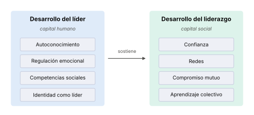

# Capítulo 3. Liderar {#sec-cap3}

::: {.callout-note appearance="default"}
## Objetivos
- Distinguir el desarrollo del líder (individual) del desarrollo del liderazgo (relacional).
- Conocer los estilos de liderazgo con más apoyo empírico y sus límites.
- Diseñar un plan de desarrollo basado en la experiencia, la retroalimentación y la reflexión.
:::

::: {.callout-note appearance="simple" icon="false"}
## Glosario del capítulo
[Liderazgo](92-glosario.qmd#gl-liderazgo) · [Desarrollo del líder](92-glosario.qmd#gl-dlider) · [Desarrollo del liderazgo](92-glosario.qmd#gl-dliderazgo) · [Liderazgo transformacional](92-glosario.qmd#gl-transformacional) · [Liderazgo transaccional](92-glosario.qmd#gl-transaccional) · [Retroalimentación 360°](92-glosario.qmd#gl-360)
:::

::: {.callout-tip appearance="simple" icon="false"}
## Descargas
[Plantilla de entrega del reto (.qmd)](plantillas/entrega_reto.qmd){.btn .btn-outline-primary .btn-sm download="entrega_reto.qmd"}
[Tema de estilo (.scss)](plantillas/informe.scss){.btn .btn-outline-primary .btn-sm download="informe.scss"}
:::

## Lectura obligatoria

::: {.lectura}
Day, D. V.; Fleenor, J. W.; Atwater, L. E.; Sturm, R. E.; McKee, R. A. (2014). [Advances in leader and leadership development: A review of 25 years of research and theory](https://doi.org/10.1016/j.leaqua.2013.11.004). *The Leadership Quarterly*, 25(1), 63-82.
:::

## 1. Liderar no es mandar

El **liderazgo** es un proceso de influencia para que un grupo alcance objetivos compartidos. No depende del cargo: una doctoranda que organiza un seminario, coordina una base de datos común o media en un conflicto ejerce liderazgo.

@day2014 distinguen dos cosas que a menudo se confunden:

- **Desarrollo del líder**: ampliar las capacidades de una persona (autoconocimiento, regulación emocional, competencias sociales, identidad como líder). Es **capital humano**.
- **Desarrollo del liderazgo**: ampliar la capacidad de un **grupo** para trabajar juntos (confianza, redes, compromiso mutuo). Es **capital social**.

Su revisión de 25 años concluye que el desarrollo es un proceso **largo**, que ocurre sobre todo **a través de la experiencia** (con retos, retroalimentación y reflexión) y que está ligado a la identidad: quien empieza a verse como líder busca más oportunidades de liderar.

## 2. Estilos con apoyo empírico

| Estilo | En qué consiste | En un grupo de investigación |
|---|---|---|
| **Transformacional** | Visión inspiradora, estímulo intelectual, atención individual, ejemplo | Contagiar una pregunta científica; desafiar ideas; cuidar a cada persona |
| **Transaccional** | Acuerdos claros, reconocimiento por resultados, corrección de desviaciones | Hitos, plazos, criterios de autoría pactados |
| **De servicio** | Priorizar el desarrollo y el bienestar del equipo | Abrir oportunidades a doctorandos, ceder protagonismo |
| ***Laissez-faire*** | Ausencia de liderazgo: evitar decisiones y responsabilidades | Directores ilocalizables, conflictos sin resolver |

La investigación asocia el liderazgo transformacional y el transaccional constructivo con mejores resultados, y el *laissez-faire* con peores. Pero ningún estilo es universal: el buen liderazgo **se adapta** a la persona y a la situación (una doctoranda de primer año necesita más estructura que un posdoc con experiencia).

{#fig-e3-desarrollo fig-alt="Dos columnas. Desarrollo del líder: autoconocimiento, regulación, competencias, identidad. Desarrollo del liderazgo: confianza, redes, compromiso mutuo, aprendizaje colectivo. Una flecha une ambas, indicando que el primero sostiene al segundo."}

## 3. Cómo se desarrolla

1. **Experiencias exigentes**: asumir responsabilidades nuevas (coordinar, organizar, mediar).
2. **Retroalimentación**: pedirla de forma sistemática; la **retroalimentación 360°** combina la visión de superiores, iguales y personas a tu cargo.
3. **Reflexión**: diario de aprendizaje, conversaciones con un mentor.
4. **Práctica deliberada** de conductas concretas, no de rasgos abstractos.

## Laboratorio: tu perfil de conductas de liderazgo {#lab-e3-perfil}

::: {.laboratorio}
::: {.laboratorio-etiqueta}
Laboratorio · se ejecuta en tu navegador
:::

Valora de 1 (casi nunca) a 5 (casi siempre) con qué frecuencia haces cada conducta. Lo ideal es pedir a dos o tres personas que te valoren también y comparar.

```{ojs}
//| echo: false
rango = window.Lab.rango
viewof l1 = rango("Comparto una visión clara de hacia dónde vamos", [1, 5], {value: 3})
viewof l2 = rango("Animo a cuestionar ideas, incluidas las mías", [1, 5], {value: 4})
viewof l3 = rango("Presto atención a las necesidades de cada persona", [1, 5], {value: 3})
viewof l4 = rango("Acuerdo expectativas y plazos de forma explícita", [1, 5], {value: 2})
viewof l5 = rango("Reconozco el trabajo bien hecho", [1, 5], {value: 3})
viewof l6 = rango("Abordo los problemas y conflictos a tiempo", [1, 5], {value: 2})
```

```{ojs}
//| echo: false
{
  const ej = [["Visión", l1], ["Estímulo intelectual", l2], ["Atención individual", l3], ["Expectativas claras", l4], ["Reconocimiento", l5], ["Afrontar problemas", l6]];
  const cx = 170, cy = 150, R = 110, ang = i => -Math.PI / 2 + i * 2 * Math.PI / 6, P = (i, v) => [cx + R * v / 5 * Math.cos(ang(i)), cy + R * v / 5 * Math.sin(ang(i))];
  const red = [1, 2, 3, 4, 5].map(v => `<polygon points="${ej.map((_, i) => P(i, v).join(",")).join(" ")}" fill="none" stroke="currentColor" opacity=".2"/>`).join("");
  const eti = ej.map(([n], i) => { const [x, y] = P(i, 6.1); return `<text x="${x}" y="${y}" text-anchor="middle" font-size="11.5" fill="currentColor">${n}</text>`; }).join("");
  const pol = `<polygon points="${ej.map(([, v], i) => P(i, v).join(",")).join(" ")}" fill="#2a78d6" fill-opacity=".3" stroke="#2a78d6" stroke-width="2"/>`;
  const orden = [...ej].sort((a, b) => a[1] - b[1]);
  const d = html`<div role="status"></div>`;
  d.innerHTML = `<svg viewBox="-10 0 360 300" width="100%" style="max-width:420px" role="img" aria-label="Gráfico radial de las seis conductas">${red}${eti}${pol}</svg>
   <p>Punto fuerte: <strong>${orden[5][0].toLowerCase()}</strong> (${orden[5][1]}). Área de mejora: <strong>${orden[0][0].toLowerCase()}</strong> (${orden[0][1]}).</p>
   <p class="small">Las cuatro primeras conductas son propias del liderazgo transformacional; expectativas y reconocimiento, del transaccional constructivo; afrontar los problemas es lo contrario del <em>laissez-faire</em>. Elige una sola conducta para practicar este mes.</p>`;
  return d;
}
```
:::

## Caso práctico resuelto

::: {.callout-note appearance="simple" icon="false"}
## Coordinar un seminario de doctorandos sin cargo formal
Una doctoranda organiza el seminario mensual de su programa. No tiene autoridad formal, pero ejerce liderazgo:

- **Visión:** «un espacio para presentar trabajo en curso sin miedo a equivocarse».
- **Expectativas claras:** calendario semestral, 20 minutos por presentación, comentarios en formato «qué funciona, qué mejoraría».
- **Atención individual:** pregunta a cada persona qué tipo de comentarios necesita.
- **Reconocimiento:** agradece en público las presentaciones y los buenos comentarios.
- **Afrontar problemas:** cuando un asistente monopoliza los turnos, habla con él en privado y propone un orden de palabra.

Resultado: más asistencia y presentaciones más tempranas (menos «trabajo acabado»).
:::

## Segundo caso práctico resuelto

::: {.callout-note appearance="simple" icon="false"}
## Adaptar el estilo a cada persona
Una investigadora recién llegada a coordinar un proyecto tiene tres personas a su cargo y tiende a tratarlas igual. Al analizar cada caso, ajusta el estilo a la competencia y la confianza de cada una en la tarea concreta:

| Persona y tarea | Situación | Estilo útil | Qué hace en la práctica |
|---|---|---|---|
| Técnica nueva, limpieza de datos | Poca experiencia, mucha motivación | **Directivo** | Instrucciones claras, ejemplos, revisión frecuente |
| Doctoranda, análisis estadístico | Sabe, pero duda | **De apoyo** | Preguntas, ánimo, deja que decida |
| Posdoc, redacción del artículo | Experta y segura | **Delegador** | Fija el objetivo y la fecha; no supervisa cada paso |

El error inicial era aplicar a todos el estilo delegador: la técnica nueva se bloqueó y nadie lo notó en dos semanas. La lección: el estilo se elige **por persona y por tarea**, y cambia a medida que la persona gana autonomía.
:::

```{dot}
//| label: fig-e3-estilos
//| fig-cap: "El estilo evoluciona con la autonomía de la persona en cada tarea."
//| fig-alt: "Secuencia de tres estilos de izquierda a derecha: directivo, de apoyo y delegador, unidos por flechas que indican que la persona gana competencia y confianza."
digraph {
  bgcolor="white"; pad=0.2; rankdir=LR;
  node [shape=box, style="rounded,filled", fillcolor="#eef3fb", color="#1a4d8f", fontname="Helvetica", fontsize=11];
  edge [color="#45433f", fontname="Helvetica", fontsize=10];
  d [label="Directivo\nqué y cómo"]; a [label="De apoyo\npreguntar y animar"]; g [label="Delegador\nobjetivo y fecha", fillcolor="#eaf6ef"];
  d -> a [label="gana competencia"]; a -> g [label="gana confianza"];
}
```

## Ejercicios graduados

**Básico.** ¿Qué conducta de liderazgo transaccional aparece en el caso?

::: {.webex-solution boton="Ver solución"}
Las expectativas claras (calendario, tiempos, formato de comentarios) y el reconocimiento.
:::

**Avanzado.** Identifica una situación en tu entorno en la que podrías ejercer liderazgo sin cargo y diseña tres conductas concretas.

::: {.webex-solution boton="Ver solución"}
Las conductas deben ser observables y relacionarse con los estilos del capítulo (visión, estímulo intelectual, atención individual, expectativas, reconocimiento).
:::


## Actividades

::: {.clasificar #ia-e3-estilo titulo="¿Qué estilo de liderazgo describe?" categorias="Transformacional|Transaccional|De servicio|Laissez-faire"}
- La directora explica por qué la pregunta del proyecto importa para la sociedad → Transformacional
- Se acuerdan por escrito los hitos de la tesis y se revisan cada trimestre → Transaccional
- El investigador principal cede la presentación en el congreso a la doctoranda → De servicio
- El director no responde a los borradores durante meses → Laissez-faire
- La coordinadora reta al grupo a buscar explicaciones alternativas a sus resultados → Transformacional
:::

::: {.clasificar #ia-e3-dev titulo="¿Desarrollo del líder o del liderazgo? [@day2014]" categorias="Desarrollo del líder|Desarrollo del liderazgo"}
- Un curso de regulación emocional para una investigadora → Desarrollo del líder
- Un retiro del grupo para acordar normas de colaboración → Desarrollo del liderazgo
- Llevar un diario de reflexión tras cada reunión que diriges → Desarrollo del líder
- Crear una red de mentoría entre doctorandos de varios grupos → Desarrollo del liderazgo
:::

## Reto evaluable {#reto-e3}

::: {.callout-important appearance="simple" icon="false"}
## Reto del capítulo 3 · Un mes de práctica deliberada
1. Completa el laboratorio y pide a dos o tres personas de tu entorno que valoren las mismas conductas (anónimamente si es posible).
2. Elige **una** conducta y diseña un plan de un mes: qué harás, en qué situaciones y cómo pedirás retroalimentación.
3. Lleva un diario breve (cinco minutos por semana) y escribe al final una reflexión con lo aprendido.

**Entrega:** con la [plantilla de entrega](plantillas/entrega_reto.qmd). Este reto **no tiene solución en el libro**.
:::

## Autoevaluación

Responde a todas las preguntas y pulsa **Mostrar respuestas**. No cuenta para la nota.

::: {.webex-check .webex-box}
1. Solo quien tiene un cargo puede ejercer liderazgo. 
2. Según @day2014, el desarrollo del liderazgo se centra en el capital 
3. El desarrollo del líder y del liderazgo ocurre sobre todo a través de la 
4. El estilo asociado con la ausencia de liderazgo es el 
5. Hay un estilo de liderazgo que funciona igual en todas las situaciones. 
6. La retroalimentación que combina superiores, iguales y personas a tu cargo es la de 360 
7. Verse a uno mismo como líder hace más probable buscar oportunidades de liderar. 
8. ¿Qué conviene practicar para desarrollar el liderazgo?


:::

::: {.webex-solution boton="Ver explicaciones"}
- El liderazgo es influencia, no cargo.
- Relaciones, confianza, redes.
- Retos, retroalimentación, reflexión.
- Evitar decisiones y responsabilidades.
- Se adapta a la persona y la situación.
- *360-degree feedback*.
- La identidad importa.
- Práctica deliberada.
:::
