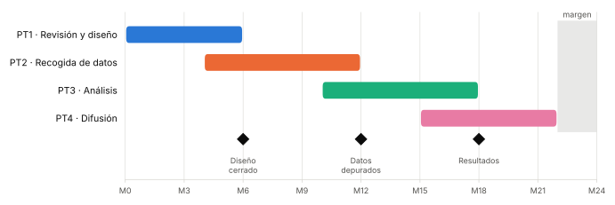

# Capítulo 5. Proyectos y financiación {#sec-cap5}

::: {.callout-note appearance="default"}
## Objetivos
- Planificar un proyecto con objetivos verificables, paquetes de trabajo, hitos y cronograma.
- Identificar, valorar y mitigar los riesgos de un proyecto.
- Preparar solicitudes de financiación competitivas.
:::

::: {.callout-note appearance="simple" icon="false"}
## Glosario del capítulo
[Objetivo SMART](92-glosario.qmd#gl-smart) · [Paquete de trabajo](92-glosario.qmd#gl-paquete) · [Hito](92-glosario.qmd#gl-hito) · [Entregable](92-glosario.qmd#gl-entregable) · [Diagrama de Gantt](92-glosario.qmd#gl-gantt) · [Matriz de riesgos](92-glosario.qmd#gl-riesgos) · [Plan de gestión de datos](92-glosario.qmd#gl-pgd)
:::

::: {.callout-tip appearance="simple" icon="false"}
## Descargas
[Plantilla de entrega del reto (.qmd)](plantillas/entrega_reto.qmd){.btn .btn-outline-primary .btn-sm download="entrega_reto.qmd"}
[Tema de estilo (.scss)](plantillas/informe.scss){.btn .btn-outline-primary .btn-sm download="informe.scss"}
:::

## Lectura obligatoria

::: {.lectura}
Bourne, P. E.; Chalupa, L. M. (2006). [Ten simple rules for getting grants](https://doi.org/10.1371/journal.pcbi.0020012). *PLoS Computational Biology*, 2(2), e12.
:::

## 1. Del objetivo al plan

Un proyecto empieza por un **objetivo general** y unos **objetivos específicos** que se puedan verificar. El acrónimo **SMART** ayuda a redactarlos: específicos, medibles, alcanzables, relevantes y con plazo (*specific, measurable, achievable, relevant, time-bound*).

- Débil: «Estudiar el abandono del doctorado».
- SMART: «Estimar, antes de diciembre de 2027, la tasa de abandono a cuatro años en los programas de doctorado de cinco universidades públicas, con datos administrativos».

Después, el trabajo se divide en **paquetes de trabajo** (conjuntos de tareas con un responsable), con **entregables** (productos concretos: un conjunto de datos, un informe, un artículo) e **hitos** (momentos de control: «datos depurados», «primer borrador»). El **diagrama de Gantt** muestra las tareas en el tiempo y sus dependencias.

{#fig-e5-gantt fig-alt="Diagrama de Gantt de 24 meses con cuatro paquetes de trabajo: revisión y diseño (meses 1-6), recogida de datos (4-12), análisis (10-18) y difusión (15-24). Rombos marcan hitos en los meses 6, 12 y 18 y una franja final indica un margen de seguridad."}

Dos consejos que la experiencia confirma: **añade márgenes** (casi todo tarda más de lo previsto) e incluye desde el principio un **plan de gestión de datos**, que muchas convocatorias exigen.

## 2. Gestionar los riesgos

Un riesgo es algo que podría ocurrir y afectaría al proyecto. La **matriz de riesgos** los valora por **probabilidad** e **impacto**; los que puntúan alto en ambos necesitan un plan de **mitigación** (reducir la probabilidad) y de **contingencia** (qué hacer si ocurre).

## Laboratorio: matriz de riesgos {#lab-e5-riesgos}

::: {.laboratorio}
::: {.laboratorio-etiqueta}
Laboratorio · se ejecuta en tu navegador
:::

Escribe un riesgo por línea con el formato `riesgo; probabilidad (1-5); impacto (1-5)`.

```{ojs}
//| echo: false
area = window.Lab.area
viewof riesgos = area("Riesgos del proyecto", {rows: 5, submit: "Valorar", value: "Retraso en el acceso a los datos administrativos; 4; 5\nBaja tasa de respuesta de los programas; 3; 3\nMarcha de la persona contratada; 2; 4\nFallo del servidor de análisis; 1; 2\nCambio de normativa de protección de datos; 2; 5"})
```

```{ojs}
//| echo: false
{
  const fs = riesgos.split("\n").map(l => l.split(";").map(s => s.trim())).filter(f => f.length >= 3 && f[0])
    .map(([t, p, i]) => ({t, p: Math.min(5, Math.max(1, +p || 1)), i: Math.min(5, Math.max(1, +i || 1))})).map(r => ({...r, v: r.p * r.i})).sort((a, b) => b.v - a.v);
  const nivel = v => v >= 15 ? ["Alto", "lab-mal", "Mitigación y contingencia obligatorias; vigílalo cada mes."] : v >= 8 ? ["Medio", "lab-medio", "Plan de mitigación y responsable."] : ["Bajo", "lab-bien", "Basta con vigilarlo."];
  const col = (p, i) => p * i >= 15 ? "#e0533d" : p * i >= 8 ? "#eda100" : "#1baf7a";
  let celdas = "";
  for (let p = 1; p <= 5; p++) for (let i = 1; i <= 5; i++) celdas += `<rect x="${40 + (i - 1) * 50}" y="${10 + (5 - p) * 40}" width="48" height="38" fill="${col(p, i)}" opacity=".28"/>`;
  const marcas = fs.map((r, k) => { const mismos = fs.slice(0, k).filter(o => o.p === r.p && o.i === r.i).length;
    return `<circle cx="${40 + (r.i - 1) * 50 + 24 + mismos * 10 - 5}" cy="${10 + (5 - r.p) * 40 + 19}" r="10" fill="#0b0b0b" stroke="#fff" stroke-width="1.5"/><text x="${40 + (r.i - 1) * 50 + 24 + mismos * 10 - 5}" y="${10 + (5 - r.p) * 40 + 23.5}" text-anchor="middle" font-size="12" font-weight="700" fill="#fff">${k + 1}</text>`; }).join("");
  const d = html`<div role="status"></div>`;
  d.innerHTML = `<svg viewBox="0 0 300 240" width="100%" style="max-width:360px" role="img" aria-label="Matriz de probabilidad por impacto con los riesgos numerados">${celdas}${marcas}
    <text x="165" y="232" text-anchor="middle" font-size="12" fill="currentColor">Impacto →</text><text x="18" y="110" text-anchor="middle" font-size="12" fill="currentColor" transform="rotate(-90 18 110)">Probabilidad →</text></svg>
    <ol>${fs.map(r => { const [n, c, a] = nivel(r.v); return `<li>${r.t.replace(/</g, "&lt;")} · ${r.p} × ${r.i} = ${r.v} · <span class="${c}" style="font-weight:600">${n}</span>. ${a}</li>`; }).join("")}</ol>`;
  return d;
}
```
:::

## 3. Conseguir financiación

@bourne2006 resumen en diez reglas lo que separa las solicitudes financiadas de las demás. Entre ellas:

- **Lee las bases** y la convocatoria con detalle; ajusta la propuesta a lo que el financiador quiere financiar.
- **Habla con la agencia** o con quien gestiona el programa cuando sea posible.
- Escribe para un **evaluador cansado** que lee muchas solicitudes: claro, ordenado, con los objetivos en la primera página.
- Muestra que el proyecto es **viable** (resultados preliminares, equipo, recursos) sin que parezca ya hecho.
- **Pide opinión** antes de enviar a colegas que hayan evaluado o conseguido financiación.
- Si te rechazan, **lee los informes**, corrige y vuelve a presentarte: la persistencia es parte del proceso.

## Caso práctico resuelto

::: {.callout-note appearance="simple" icon="false"}
## Un cronograma realista con margen
Proyecto de 24 meses, tres paquetes de trabajo. Primera versión: todo encadenado sin huecos, terminando justo en el mes 24. Revisión:

1. **Dependencias:** el análisis no puede empezar sin datos depurados; el comité de ética debe aprobar antes de recoger datos.
2. **Ruta crítica:** ética → recogida → depuración → análisis → artículo principal. Cualquier retraso aquí retrasa el final.
3. **Margen:** 10-15 % del tiempo de la ruta crítica (unos tres meses) al final.
4. **Hitos de control** en los meses 6, 12 y 18, con decisiones previstas si hay retrasos (reducir el alcance, priorizar resultados).
:::

## Segundo caso práctico resuelto

::: {.callout-note appearance="simple" icon="false"}
## Una matriz de riesgos para una solicitud
Un equipo prepara la solicitud de un proyecto de tres años. La convocatoria pide un plan de contingencia. Valoran cada riesgo por **probabilidad** y **impacto** (de 1 a 3) y priorizan por el producto:

| Riesgo | P | I | P × I | Medida |
|---|---|---|---|---|
| No se contrata a tiempo al personal | 3 | 3 | **9** | Empezar con tareas que puede hacer el equipo actual |
| Una fuente de datos cambia sus condiciones de uso | 2 | 3 | **6** | Identificar una fuente alternativa y guardar copias |
| Baja de una investigadora clave | 1 | 3 | 3 | Documentar procesos; repartir conocimientos |
| Retraso en la revisión ética | 2 | 1 | 2 | Margen de un mes en el cronograma |

Los dos primeros riesgos reciben una medida concreta en la memoria y una persona responsable. Los evaluadores no esperan un proyecto sin riesgos, sino uno que los conozca y sepa qué hará.
:::

```{dot}
//| label: fig-e5-riesgos
//| fig-cap: "Priorizar riesgos por probabilidad e impacto."
//| fig-alt: "Diagrama que lleva de la lista de riesgos a una valoración de probabilidad por impacto y, según el resultado, a medidas preventivas para los riesgos altos y a vigilancia para los bajos."
digraph {
  bgcolor="white"; pad=0.2; rankdir=LR;
  node [shape=box, style="rounded,filled", fillcolor="#eef3fb", color="#1a4d8f", fontname="Helvetica", fontsize=11];
  edge [color="#45433f", fontname="Helvetica", fontsize=10];
  L [label="Lista de riesgos"]; V [label="Probabilidad × impacto"];
  Al [label="Alto (≥ 6)\nmedida y responsable", fillcolor="#fdf0e8"]; B [label="Bajo (< 6)\nvigilar", fillcolor="#eaf6ef"];
  L -> V; V -> Al; V -> B;
}
```

## Ejercicios graduados

**Básico.** ¿Qué es la ruta crítica de un proyecto?

::: {.webex-solution boton="Ver solución"}
La secuencia de tareas dependientes cuya duración determina la fecha final: cualquier retraso en ellas retrasa todo el proyecto.
:::

**Avanzado.** Dibuja el diagrama de Gantt de tu proyecto actual, marca la ruta crítica y añade un margen justificado.

::: {.webex-solution boton="Ver solución"}
Incluye dependencias, hitos con criterios verificables y una lista de tareas que podrían recortarse si hay retrasos.
:::


## Actividades

::: {.clasificar #ia-e5-smart titulo="¿Es un objetivo SMART?" categorias="SMART|No SMART"}
- «Mejorar la comprensión del cambio climático» → No SMART // No es específico ni medible ni tiene plazo.
- «Publicar en acceso abierto, antes de junio de 2028, un conjunto de datos de 2000 encuestas anonimizadas» → SMART
- «Hacer el mejor estudio del campo» → No SMART
- «Validar, en el primer año, un cuestionario de 20 ítems con al menos 300 respuestas» → SMART
:::

::: {.ordenar #ia-e5-solicitud titulo="Ordena la preparación de una solicitud"}
1. Leer las bases y los criterios de evaluación
2. Definir objetivos SMART y la pregunta
3. Diseñar paquetes de trabajo, cronograma y presupuesto
4. Redactar la memoria
5. Pedir revisión a colegas con experiencia
6. Corregir y enviar antes del último día
:::

::: {.clasificar #ia-e5-tipo titulo="¿Entregable o hito?" categorias="Entregable|Hito"}
- Conjunto de datos depositado en un repositorio → Entregable
- Fin de la recogida de datos → Hito
- Informe técnico intermedio → Entregable
- Aprobación del comité de ética → Hito
:::

## Reto evaluable {#reto-e5}

::: {.callout-important appearance="simple" icon="false"}
## Reto del capítulo 5 · Un proyecto financiable
1. Elige una convocatoria real a la que podrías presentarte y resume sus criterios de evaluación.
2. Redacta el objetivo general y tres objetivos específicos **SMART**.
3. Diseña tres o cuatro paquetes de trabajo con entregables, hitos y un **diagrama de Gantt**.
4. Analiza cinco riesgos con el laboratorio y propón mitigaciones.

**Entrega:** con la [plantilla de entrega](plantillas/entrega_reto.qmd). Este reto **no tiene solución en el libro**.
:::

## Autoevaluación

Responde a todas las preguntas y pulsa **Mostrar respuestas**. No cuenta para la nota.

::: {.webex-check .webex-box}
1. En SMART, la T significa que el objetivo tiene 
2. Un entregable es un producto concreto del proyecto. 
3. Un momento de control del proyecto es un 
4. En una matriz de riesgos se valora la probabilidad y el 
5. @bourne2006 recomiendan escribir para un evaluador 
6. Si una solicitud es rechazada, lo mejor es no volver a presentarla. 
7. El gráfico que muestra las tareas en el tiempo es el diagrama de 
8. ¿Qué hacer con un riesgo de probabilidad e impacto altos?


:::

::: {.webex-solution boton="Ver explicaciones"}
- *Time-bound*.
- Datos, informes, artículos, software.
- *Milestone*.
- Probabilidad × impacto.
- Claridad y objetivos en la primera página.
- Los informes de evaluación ayudan a mejorar.
- Henry Gantt.
- Reducir la probabilidad y saber qué hacer si ocurre.
:::
